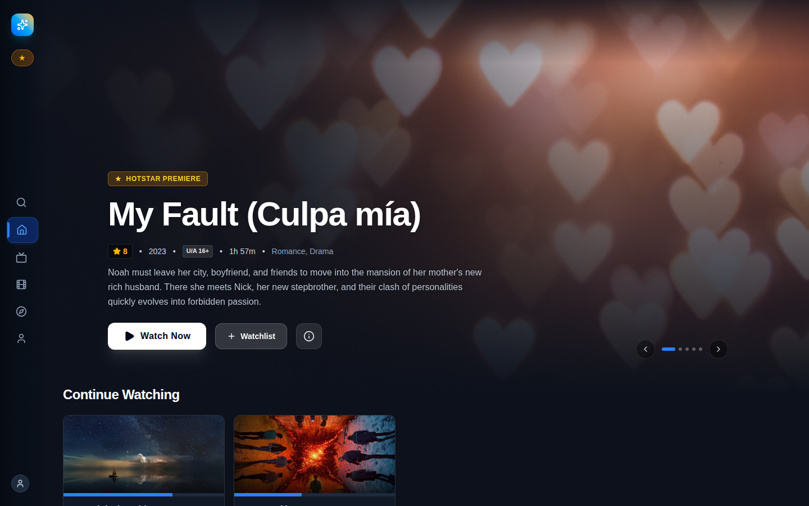
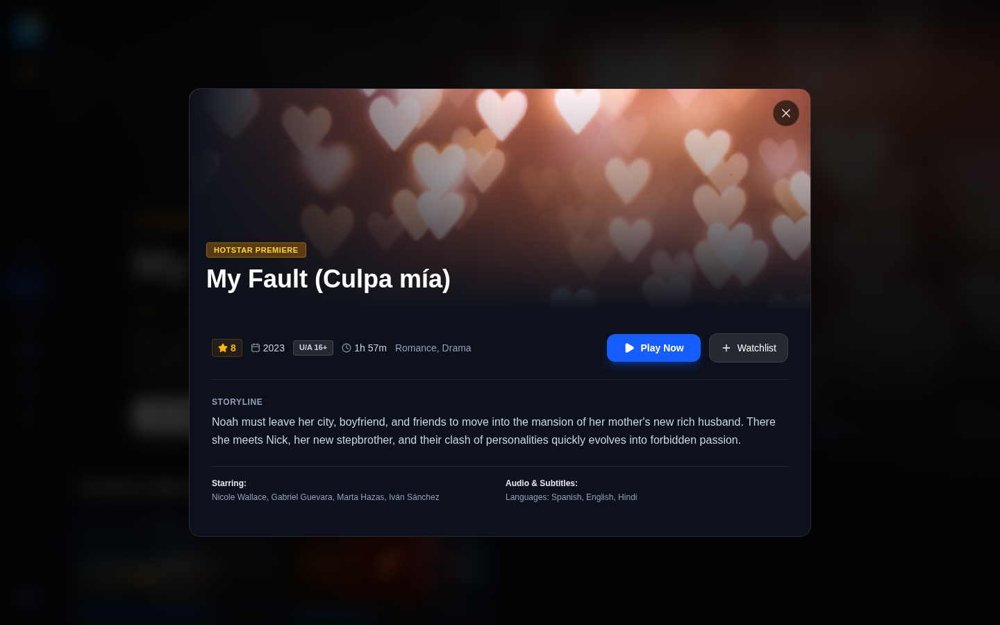
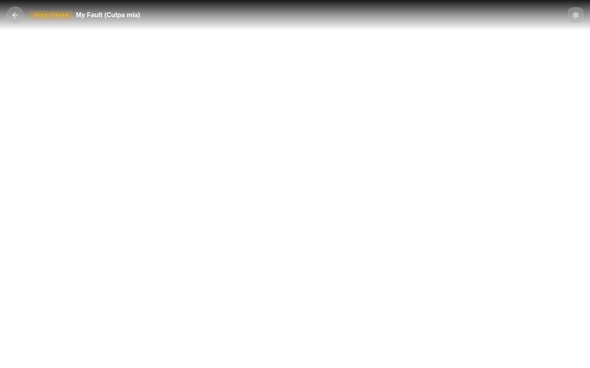
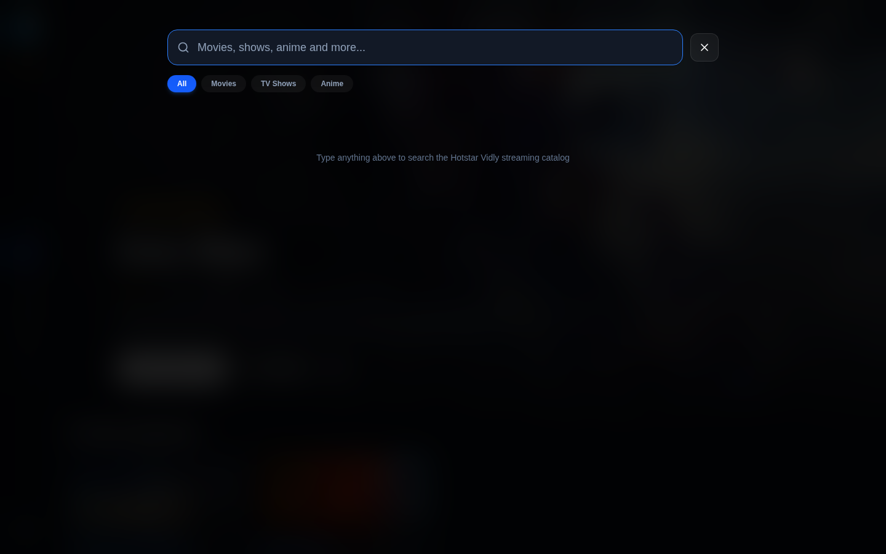
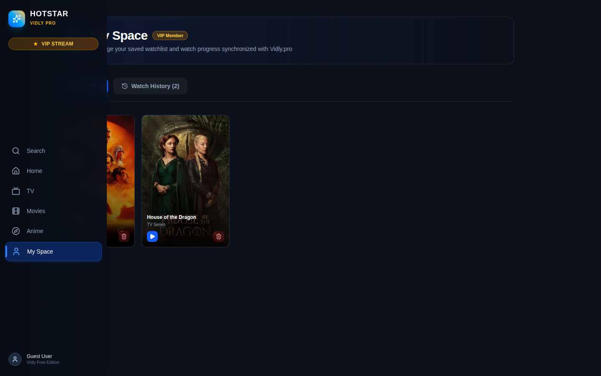

# Vidly Hotstar OTT Platform (Pure Frontend with IndexedDB)

A Disney+ Hotstar inspired, pure client-side OTT streaming web platform powered by the **[Vidly.pro API](https://vidly.pro/#api)** and **IndexedDB** for offline storage. Zero backend required.

---

## 📸 UI Showcase & Screenshots

### 1. Hotstar Homepage & Hero Billboard
Dynamic hero banner with synopsis, metadata badges (HD, 4K, Dolby 5.1), and Top 10 numbered ranking carousels.


---

### 2. Media Detail & Episode Picker
Modal view with backdrop artwork, rating, genre tags, quick actions (Add to Watchlist, Play), and season/episode selector rails for TV shows and anime.


---

### 3. Integrated Vidly.pro Embed Player
Embedded Vidly player iframe supporting custom theme options (`theme=hotstar`, `color=00ed82`, `autoplay`), start timestamp offsets, and live postMessage sync.


---

### 4. Live Search & Filter Overlay
Real-time instant search with Hotstar category pills (Movies, Shows, Anime, Action, Sci-Fi) and responsive card grid.


---

### 5. My Space (Watchlist & Vidly Playback History via IndexedDB)
Dedicated profile hub tracking user watchlists and synchronized Vidly playback timestamps with percent progress bars stored in the browser's IndexedDB.


---

## 🌟 Key Features

1. **Disney+ Hotstar OTT Aesthetic**:
   - Signature midnight palette (`#0c111b`, `#141b29`, `#00ed82`, `#0078f2`).
   - Collapsible left sidebar navigation (Home, TV, Movies, Anime, My Space, Search).
   - Top 10 numbered ranking badges and horizontal scrolling rails.
   - Glassmorphic modal overlays and responsive card zoom animations.

2. **Vidly.pro API Integration**:
   - **Movies**: `https://vidly.pro/embed/movie/{tmdb_id}`
   - **TV Shows**: `https://vidly.pro/embed/tv/{tmdb_id}/{season}/{episode}`
   - **Anime**: `https://vidly.pro/embed/anime/{id}/{ep}/{audio}` (sub/dub selector)
   - Custom parameters: `theme=hotstar`, `color=00ed82`, `autoplay=true`, `startAt={seconds}`
   - **Real-time Synchronization**: Listens for window `message` events (`SYNC_HISTORY` and `VIDLY_PLAYER_EVENT`) to automatically record current watch progress into IndexedDB.

3. **Pure Frontend Architecture with IndexedDB**:
   - Zero backend server required.
   - All user watchlists and watch history are stored locally using browser **IndexedDB** (`vidly_ott_db` database) with graceful fallback to `localStorage`.
   - Instant search and category filtering running entirely client-side.

---

## 🚀 Getting Started

### Prerequisites
- Node.js (v18+)
- npm

### 1. Install Dependencies
```bash
npm --prefix client install
```

### 2. Run in Development Mode
```bash
npm run dev
# Or: npm --prefix client run dev
```
Open **`http://localhost:5173`** in your browser.

### 3. Build for Production
```bash
npm run build
# Or: npm --prefix client run build
```

---

## 🛠️ Tech Stack
- **Framework**: React 19 + Vite
- **Styling**: Tailwind CSS v4 + Lucide React icons
- **Persistence**: Browser IndexedDB (`vidly_ott_db`) + localStorage fallback
- **Video Embed API**: [Vidly.pro](https://vidly.pro/#api)
